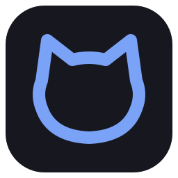
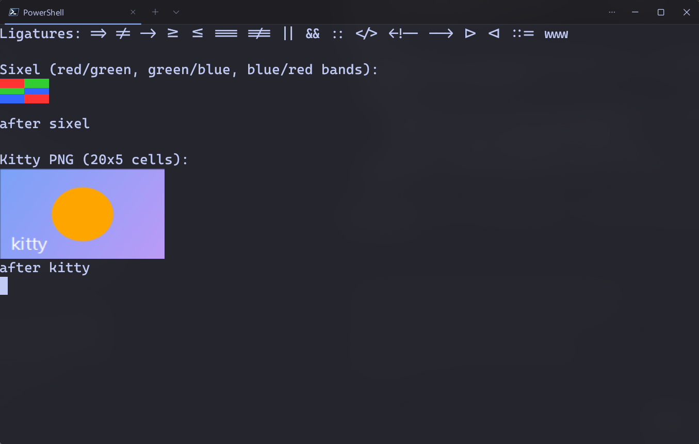
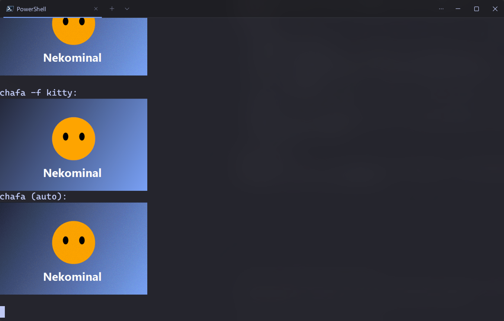
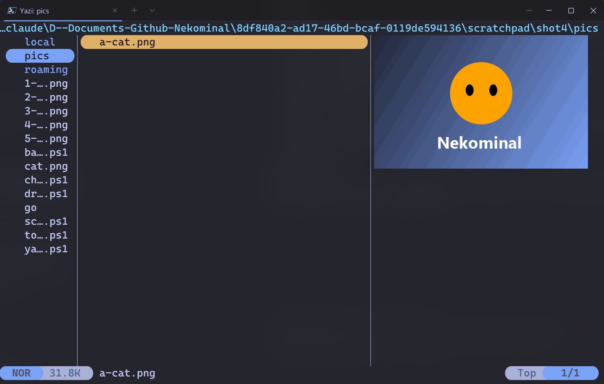

<p align="center">
  
</p>

<h1 align="center">Nekominal</h1>

<p align="center">
  <strong>A Windows terminal made for coding agents.</strong><br>
  Native Rust, Direct3D and ConPTY. It shows which tabs are working and which wait for you.
</p>

<p align="center">
  <a href="https://github.com/KoukeNeko/Nekominal/releases/latest"></a>
  <a href="https://github.com/KoukeNeko/Nekominal/actions/workflows/ci.yml"></a>
  
  
  <a href="LICENSE"></a>
</p>

<p align="center">
  <strong>English</strong> · <a href="README.zh-TW.md">繁體中文</a>
</p>

<p align="center">
  <a href="#getting-started">Getting started</a>
  · <a href="#what-it-does">Features</a>
  · <a href="#shortcuts">Shortcuts</a>
  · <a href="distribution/release-notes">Release notes</a>
  · <a href="#technical-reference">Technical reference</a>
</p>

```powershell
scoop bucket add koukeneko https://github.com/KoukeNeko/scoop-bucket
scoop install koukeneko/nekominal

nekominal -d D:\src\app                            # a tab in that folder
nekominal -d D:\src\app `; sp -V -p "Ubuntu"         # and WSL in a pane beside it
```

Nekominal is a terminal for Windows written in Rust, with no web technology in it: a plain Win32 window, Direct3D 11 for the
text and the interface, DirectComposition over a Mica or acrylic backdrop, and ConPTY for the shells. Claude Code runs in it,
including its full-screen mode.

**It knows what your agents are doing.** Each tab shows whether its agent is working, waiting for an answer, done, or failed.
The sidebar can sort the tabs into those groups, and the title bar counts the ones that wait for you; one key goes to the
next. For Claude Code the title bar also shows the model, the share of the context used, the cost and the time, next to the
branch and the folder.

**It treats what programs print as untrusted.** A link printed by a program never runs a program on Ctrl+click, a flood of
escape sequences or combining marks cannot freeze the window, and a program can write to the clipboard only as the settings
allow. Large and multi-line pastes ask first.

| Inline images (Sixel, kitty) and ligatures | `chafa` in Sixel, kitty and its own detection | `yazi` previewing a picture |
| :---: | :---: | :---: |
|  |  |  |

## What it does

### Made for agents

- **States you can see.** A tab at work spins, a tab that waits pulses, a failed one turns red. With the tabs in the sidebar,
  grouped by state: *waiting*, *working*, *done*, *other*. Ctrl+Shift+U goes to the next tab that waits.
- **Three styles of sidebar.** *Activity* shows what each agent last said or the last command, with its context and cost;
  *Agent cards* gives each tab a card with a preview, its model and its numbers; *By repository* puts the tabs under the
  repository they are in, worktrees under their main folder, with what each repository cost.
- **Pull requests and ports on the tabs.** A tab in a GitHub repository shows its PR and checks (passing, failing,
  running, draft, merged), and every port its programs listen on. A click opens the PR or `localhost` (`gh` for the PR).
- **Phone notifications.** What would raise a Windows notification can also go to an ntfy topic or any https webhook,
  while you are away from the PC or always, for the events you pick.
- **Claude Code in the title bar.** Nekominal hands Claude Code a status line of its own (only when you have none), and shows
  the model, the context meter, the cost and the time, with the branch and the folder.
- **Codex, Gemini CLI and Aider too.** Typed in a PowerShell tab, each gets Nekominal as its hook for that run (never written
  to its own config, and not where you set that hook yourself), so its tab says when it works, waits or is done.
- **Agents panel (Ctrl+Shift+J).** Every pane that runs an agent, in every window: its state, time, model, context and cost,
  the ones that wait first, and what Claude Code cost today. Choosing one goes to it.
- **Agent status protocol (OSC 7501)**, progress (OSC 9;4) and notifications (OSC 9, OSC 777) from any program, shown on its
  tab and raised to the taskbar when the window is in the background.
- **A tab in a new git worktree.** Type a branch name in the palette: Nekominal runs `git worktree add` beside the
  repository (branch `fix/login` of `app` goes to `app-fix-login`) and opens a tab there named after the branch, so each
  agent has files of its own. The ignored files that a `.worktreeinclude` at the root names (one `.gitignore` pattern a
  line, such as `.env`) are copied into it, and the tab types the command that runs `.nekominal\setup.ps1` (or
  `.nekominal\setup.cmd`) when the repository has one, for you to run with Enter. "Remove this worktree" shows what would be lost (changed files,
  commits not pushed, whether it is merged) and lets you keep or delete the branch; it never forces, and never touches the
  main checkout.
- **Automation.** `nekominal cli` (`list`, `send-text`, `get-text`, `new-tab`, `split`, `focus`, `close`, `notify`,
  `subscribe`) drives the running terminal over a named pipe only you can open, so scripts and agents can open panes and
  read them.

### Commands and their output

- **Shell integration for PowerShell, cmd, Git Bash and WSL bash** marks every prompt, command and exit code (OSC 133) and the folder (OSC 9;9), with no
  change to your profile.
- **Select or copy a command's output** from the palette; press again for the command before it. Failed commands get a red
  mark on the scrollbar, and Ctrl+Alt+Up / Down jumps between prompts.
- **Hints (Ctrl+Shift+E).** Every URL, file path (with its `:line:col`) and git hash on the screen gets a one-letter label.
  Type it to copy, Shift+letter to open: a path with a line opens at that line in VS Code (else Cursor, Windsurf or Zed,
  or the command of the `editor` setting). Ctrl+click does the same on a printed `src\main.rs:12:5`.
- **Search all tabs (Ctrl+Shift+G)** lists every match in every pane with the title of its tab; Enter goes there.
- **Keyboard selection (Ctrl+Shift+M)**, block selection with Alt+drag, copy with formatting (HTML), export of a whole pane
  to a file, find with case and regular expressions.
- **Suggestions (Ctrl+Shift+H)** from your snippets and from PowerShell's history.
- **Triggers.** Rules that watch the output: when a line matches, highlight it, notify, mark the tab, ring, or send a reply
  (off until you allow it). Each rule is edited with a live match against the last lines of the current tab.
- **Paste an image, drop files.** A pasted screenshot is saved and its path typed, so an agent can read it; files copied in
  Explorer or dropped on a pane type their paths, in WSL form in a WSL tab.

### Tabs, panes and windows

- Tabs on top or in a sidebar, chosen at the first start. Rename, colour, duplicate, move, close the others.
- Split panes, zoom one, swap them, move one into a tab of its own, or type into all of them at once.
- Drag a tab out of the window to make a window of it, or onto another window.
- A drop-down window on **Win+`**, focus mode, always on top, full screen.
- The tabs, panes and their folders come back at the next start, if you want them to.
- Save the tabs of a window as a named layout, and open it again from the palette, here or in a new window, or with
  `nekominal --layout <name>`.

### Profiles

- Found on the machine: PowerShell 7 and Windows PowerShell, cmd, Git Bash, every WSL distribution, the Visual Studio
  developer shells, and the hosts in your `~/.ssh/config`.
- Each profile can have its own environment variables, colour scheme, font size, starting folder, and **run as
  administrator**. A page of the settings edits them, with a file picker for the program and the folder.
- A new tab gets the environment Windows gives a new program, as Windows Terminal does, so a tool installed a minute ago is
  on its `PATH`.

### Looks

- Mica, Mica Alt, acrylic or none, with an opacity of your choice.
- Built-in colour schemes, your own in Windows Terminal's format, an import of the schemes of your Windows Terminal, and
  of iTerm2 colour presets (`.itermcolors`), such as those of iTerm2-Color-Schemes.
- Your fonts, line height, cursor shape and blink rate. The text keeps its contrast on every scheme.
- Font ligatures (`=>`, `!=` as one glyph) with fonts that have them, such as Cascadia Code; off by default, in
  Settings › Appearance. The cursor and a selection break them.
- Inline images: Sixel and the kitty graphics protocol (PNG, raw pixels, compressed and chunked), so `chafa`, `timg`,
  `yazi` and `kitty +kitten icat` show pictures. They scroll with the text, and a program can make the terminal hold only
  so much.

### At home in Windows

- **Open in Nekominal** in Explorer's right-click menu, as *here* or *as administrator*.
- The profiles on the taskbar button's jump list.
- A command line like `wt`: `-d`, `-p`, `nt`, `sp -H/-V`, a command after `--`, and several actions separated by `;`.
- **Update and restart** from the command palette or the About page, through Scoop.
- Screen readers see the tabs, the text, the settings and the menus (UI Automation). IME composition is drawn in place.
  Traditional Chinese and English.

### How it compares

|                                   | Nekominal | Windows Terminal | WezTerm |
| --------------------------------- | :-------: | :--------------: | :-----: |
| Agent state on every tab          |    ✅     |        —         |    —    |
| Claude Code status in the window  |    ✅     |        —         |    —    |
| Tabs grouped by state             |    ✅     |        —         |    —    |
| Pull requests and ports on tabs   |    ✅     |        —         |    —    |
| Command-line control of a window  |    ✅     |        ⚠️        |   ✅    |
| Select a command's output         |    ✅     |        ✅        |   ✅    |
| Hints / quick select              |    ✅     |        —         |   ✅    |
| Fresh environment for a new tab   |    ✅     |        ✅        |    —    |
| Explorer menu, jump list          |    ✅     |        ✅        |   ⚠️    |
| Custom colour schemes             |    ✅     |        ✅        |   ✅    |
| Inline images (Sixel, kitty)      |    ✅     |        ⚠️        |   ✅    |
| Font ligatures                    |    ✅     |        ✅        |   ✅    |
| Default terminal of Windows       |    —      |        ✅        |    —    |
| macOS and Linux                   |    —      |        —         |   ✅    |

⚠️ partly: Windows Terminal has Sixel but not the kitty protocol, and `wt` opens tabs and panes but cannot read or type
into them; WezTerm's installer adds an Explorer entry but no jump list.

## Getting started

1. **Install** with [Scoop](https://scoop.sh):

   ```powershell
   scoop bucket add koukeneko https://github.com/KoukeNeko/scoop-bucket
   scoop install koukeneko/nekominal
   ```

   Scoop picks the x64 or the ARM64 build. Each [release](https://github.com/KoukeNeko/Nekominal/releases) is also a zip:
   unpack it anywhere and run `Nekominal.exe`, keeping `conpty.dll` and `OpenConsole.exe` beside it.

2. **Choose where the tabs go.** The first start asks: on top, as a list in a sidebar, or as icons. Settings › Appearance
   changes it later.

3. **Run an agent.** Type `claude` in a PowerShell tab. Its state shows on the tab, and the model, context and cost in the
   title bar.

4. **Make it yours.** Ctrl+Shift+O opens the settings in a tab: profiles, schemes, fonts, shortcuts, triggers, phone
   notifications, the style of the sidebar. Everything is also in `%APPDATA%\Nekominal\settings.json`, which the settings
   open for you.

5. **Start it from anywhere.** Right-click a folder in Explorer, pick a profile from the taskbar button, or script it:

   ```powershell
   nekominal -p cmd -d D:\src\app
   ```

## Shortcuts

| Action | Shortcut |
| --- | --- |
| New tab · choose a profile | Ctrl+Shift+T · Ctrl+Shift+N |
| Next tab · tab 1–9 · tab left / right | Ctrl+Tab · Ctrl+Shift+1–9 · Ctrl+PageUp / PageDown |
| Next tab that waits for you · agents panel | Ctrl+Shift+U · Ctrl+Shift+J |
| Split right · split down | Alt+Shift+D · Alt+Shift+S |
| Move between panes · resize | Alt+Arrow · Alt+Shift+Arrow |
| Zoom the pane · close it | Ctrl+Shift+Z · Ctrl+Shift+W |
| Hints · keyboard selection · suggestions | Ctrl+Shift+E · Ctrl+Shift+M · Ctrl+Shift+H |
| Previous / next prompt | Ctrl+Alt+Up / Down |
| Find · search all tabs · command palette · settings | Ctrl+Shift+F · Ctrl+Shift+G · Ctrl+Shift+P · Ctrl+Shift+O |
| Font size | Ctrl+= · Ctrl+- · Ctrl+0 |
| Sidebar · full screen · drop-down window | Ctrl+Shift+B · F11 · Win+` |

Every command is in the palette, and the Shortcuts page of the settings rebinds any of them by pressing the new chord.

## Compatibility

- Windows 11 (build 22621 or later for the backdrops), on x64 and ARM64.
- Shells and agents through ConPTY, with the ConPTY that ships with each release.
- PowerShell 7, Windows PowerShell 5.1, cmd, Git Bash and the bash of WSL get the shell integration (cmd gives no exit code);
  any other shell runs as it is.

---

## Technical reference

### Settings

`%APPDATA%\Nekominal\settings.json` holds only what differs from the defaults. It may have comments; a value that cannot be
read is reported, never dropped, and the file you wrote first is kept as `settings.json.orig`.

```jsonc
{
  "theme": "Tokyo Night",
  "profiles": [
    { "id": "pwsh", "cwd": "D:\\src", "env": { "LANG": "zh_TW.UTF-8" } },
    { "id": "admin", "name": "Admin PowerShell", "program": "pwsh.exe", "elevate": true, "colorScheme": "Nord" }
  ],
  "schemes": [
    { "name": "Mine", "background": "#1E1E2E", "foreground": "#CDD6F4", "black": "#45475A", "red": "#F38BA8", "...": "..." }
  ]
}
```

An entry with the `id` of a shell Nekominal found adjusts that shell; one with a `program` adds a profile. `schemes` uses
Windows Terminal's keys, so a scheme copied from there works as it is.

### Command line

```text
nekominal [-d <folder>] [-p <profile>] [-- <command> ...]
          [; nt <same options>] [; sp -H|-V <same options>]
```

`-p` takes a profile's id or name. In PowerShell, write `;` as `` `; `` so that PowerShell does not take it. A command after
`--` runs as it is, without the shell integration; type `claude` in a PowerShell, cmd, Git Bash or WSL bash tab to give Claude Code the status line.

### Build

Rust 1.95 or later, the Visual Studio Build Tools (with the ARM64 tools for an ARM64 build), Windows 11.

```powershell
scripts\fetch-conpty.ps1                 # the ConPTY pair, checked against a pinned hash and signature
cargo build --release -p nekominal-shell # target\release\nekominal-next.exe
scripts\package.ps1                      # dist\Nekominal-<version>-windows-x64.zip
scripts\package.ps1 -Arch arm64          # dist\Nekominal-<version>-windows-arm64.zip
```

### Tests

```powershell
cargo test --workspace                   # fast: no window, no network
cargo test --workspace -- --ignored      # also real ConPTY sessions, PowerShell and Node
```

`tools\slice-drive\next-scenarios.ps1` drives the built window with real keyboard and mouse input. The scenarios take the
foreground, so leave the machine alone while they run. The tests that run the real Claude Code CLI are in
`tools\agent-probe` and need a signed-in `claude.exe`.

### Layout

| Crate | What it holds |
| --- | --- |
| `nekominal-pty` | ConPTY host and sessions, shell discovery, the environment of a new tab |
| `nekominal-term` | the terminal emulator (around `alacritty_terminal`), links, search, OSC handling |
| `nekominal-input` | keys and the mouse, including the kitty keyboard protocol |
| `nekominal-model` | settings, profiles, commands, key map, palette, schemes, strings |
| `nekominal-render` | the Direct3D 11 grid renderer |
| `nekominal-ui` | the drawn interface: rounded rectangles, text, icons |
| `nekominal-pane` | a pane: a session, an emulator, a renderer, hints |
| `nekominal-shell` | the application: windows, tabs, sidebar, pop-ups, settings, Windows integration, updates |

### Releases

The version is `version` under `[workspace.package]` in `Cargo.toml`. Write the notes in
`distribution/release-notes/vX.Y.Z.md` (English, then Traditional Chinese), commit, and push an annotated tag:

```powershell
git tag -a v0.2.0 -m v0.2.0
git push origin v0.2.0
```

The release workflow builds and tests both archives, publishes them with those notes, and writes the Scoop manifest into
[KoukeNeko/scoop-bucket](https://github.com/KoukeNeko/scoop-bucket). A run by hand stops before publishing.

## Support

If Nekominal is useful to you, you can support its development:

<a href="https://buymeacoffee.com/doershing"></a>

## License

[MIT](LICENSE) © KoukeNeko. The ConPTY files in the release archives are Microsoft's, also under MIT; see
[THIRD-PARTY-NOTICES.md](THIRD-PARTY-NOTICES.md).
