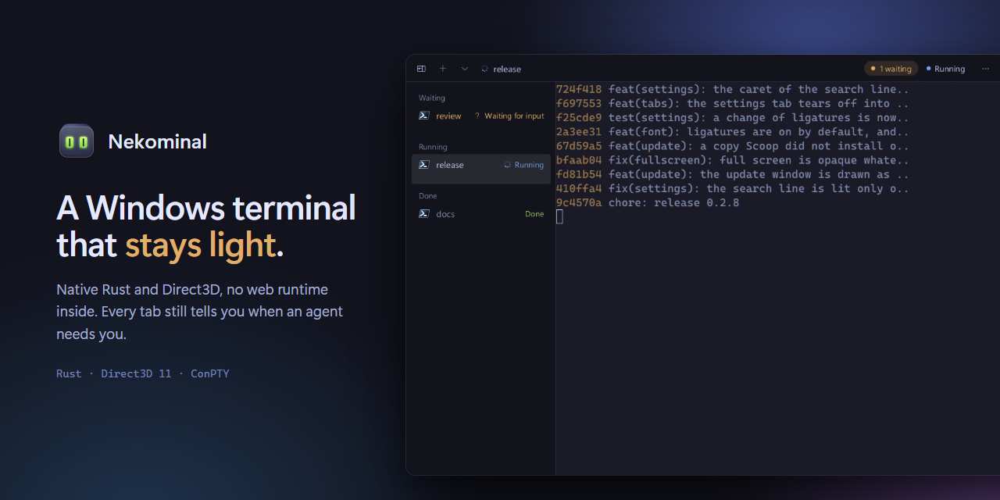
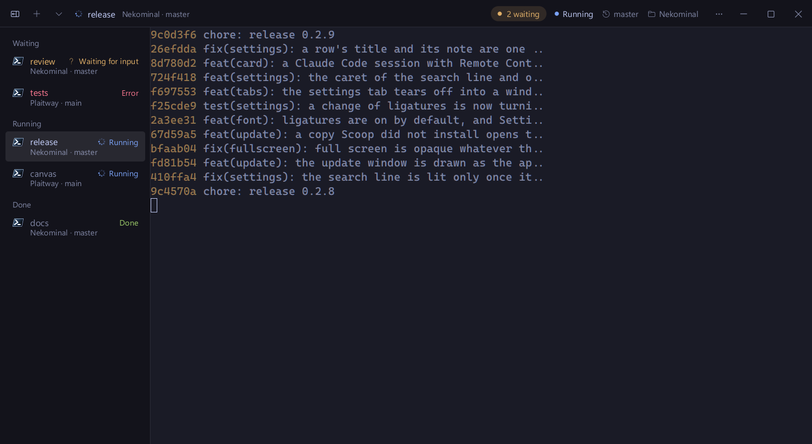
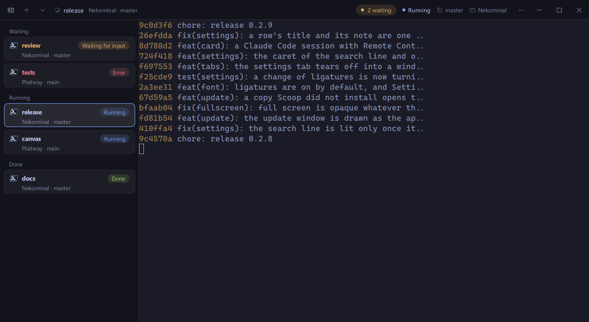
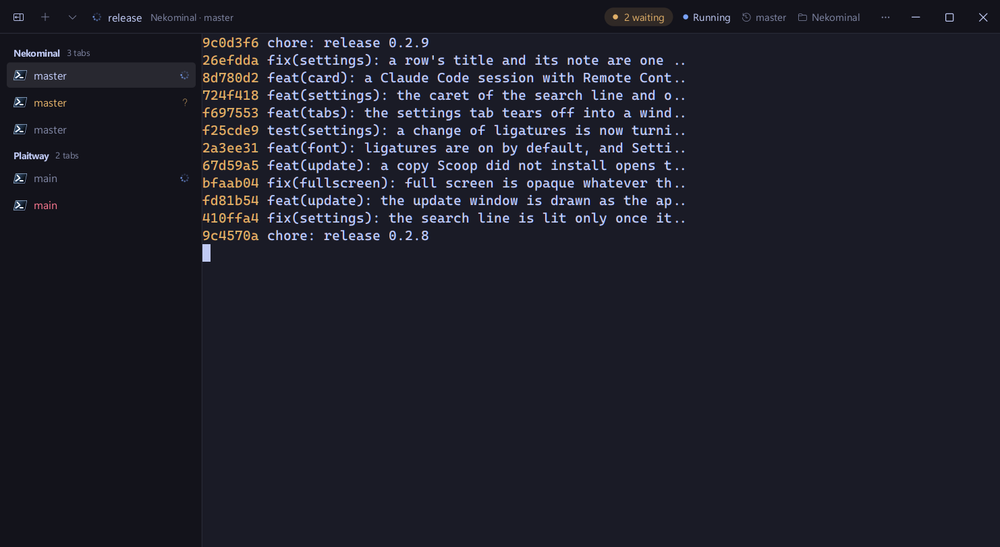

<p align="center">
  
</p>

<p align="center">
  <strong>一個輕量的 Windows 終端機。</strong><br>
  原生 Rust 與 Direct3D，內部沒有網頁執行環境；每個分頁都會告訴你哪個 agent 在等你。
</p>

<p align="center">
  <a href="https://github.com/KoukeNeko/Nekominal/releases/latest"></a>
  <a href="https://github.com/KoukeNeko/Nekominal/actions/workflows/ci.yml"></a>
  
  <a href="LICENSE"></a>
</p>

<p align="center">
  <a href="README.md">English</a> · <strong>繁體中文</strong>
</p>

```powershell
scoop bucket add koukeneko https://github.com/KoukeNeko/scoop-bucket
scoop install koukeneko/nekominal
```

<p align="center">
  也可以<a href="https://github.com/KoukeNeko/Nekominal/releases/latest">下載 zip</a>，解壓後執行 <code>Nekominal.exe</code>。支援 Windows 11，x64 或 ARM64。
</p>

## 天生輕量

Nekominal 是一個約 9 MB 的原生程式：Rust、Direct3D 11 與 ConPTY。沒有 Electron、沒有 web view，也不用另外安裝執行環境。
視窗只在畫面有變化時才重繪，所以你沒在看的終端機幾乎不花資源。

|  | Nekominal | Windows Terminal |
| --- | ---: | ---: |
| 記憶體，一個分頁 | **82 MB** | 113 MB |
| 記憶體，五個分頁 | **136 MB** | 193 MB |
| 從啟動到 shell 開始執行 | **0.70 秒** | 0.76 秒 |
| 閒置時的 CPU，一個分頁 | 每 20 秒 0.02 秒 | 每 20 秒 0.09 秒 |
| 輸出 20 MB 的文字檔 | 10.6 秒 | 10.5 秒 |

<sub>在 Windows 11 上與 Windows Terminal 1.24 比較，兩者皆為預設設定並執行 `pwsh -NoProfile`，取三次的中位數。
記憶體為終端機本身與其 OpenConsole 的 working set，不含 shell。</sub>

## 知道你的 agent 在做什麼

在分頁裡執行 Claude Code、Codex、Gemini CLI 或 Aider，分頁就會顯示它是**工作中**、**等你回應**、**已完成**還是**失敗**。
側邊欄依狀態分組，標題列會數出有幾個在等你，按 **Ctrl+Shift+U** 就跳到下一個。不用另外設定。



使用 Claude Code 時，標題列還會顯示模型、context 用量、費用與時間。滑鼠移到計量條上可看詳細資訊；工作階段連上
Remote Control 時，也能在那裡開啟或複製連結。

| Agent 卡片 | 依 repository 分組 |
| :---: | :---: |
|  |  |

## 為平行工作而做

- **每個 agent 一個 worktree。** 從命令選擇區在新的 git worktree 開分頁；移除前會先告訴你會失去什麼。
- **更新時分頁不中斷。** 按「更新並重新啟動」，每個 shell 與 agent 都會在新版本中繼續執行。
- **分頁上顯示 pull request 與 port**，agent 需要你時可透過 ntfy 或 webhook 傳到手機。
- **可用腳本控制。** `nekominal cli` 能列出、開啟、分割與讀取窗格，讓你自己的工具來操作它。

## 首先是一個好用的終端機

分割窗格、拖出分頁、Win+\` 下拉視窗、儲存版面與還原工作階段。網址、路徑與 hash 的提示模式，在編輯器開啟 `file:line`，
搜尋所有分頁。Sixel 與 kitty 圖片、字型連字、Mica 與壓克力背景，並可匯入 Windows Terminal 與 iTerm2 的配色。

## 快速鍵

| 動作 | 快速鍵 |
| --- | --- |
| 新分頁 · 選擇設定檔 | Ctrl+Shift+T · Ctrl+Shift+N |
| 下一個等你的分頁 · agent 面板 | Ctrl+Shift+U · Ctrl+Shift+J |
| 向右分割 · 向下分割 | Alt+Shift+D · Alt+Shift+S |
| 命令選擇區 · 設定 | Ctrl+Shift+P · Ctrl+Shift+O |
| 尋找 · 搜尋所有分頁 | Ctrl+Shift+F · Ctrl+Shift+G |
| 提示模式 | Ctrl+Shift+E |

所有命令都能在命令選擇區找到，所有快速鍵都可以在設定中修改。
設定檔位於 `%APPDATA%\Nekominal\settings.json`。

## 建置

```powershell
scripts\fetch-conpty.ps1
cargo build --release -p nekominal-shell
cargo test --workspace
```

需要 Rust 1.95+ 與 Visual Studio Build Tools。[版本說明](distribution/release-notes)。

## 支持

<a href="https://buymeacoffee.com/doershing"></a>

## 授權

[MIT](LICENSE) © KoukeNeko。發行檔中的 ConPTY 檔案屬於 Microsoft，同樣採用 MIT 授權；請見
[THIRD-PARTY-NOTICES.md](THIRD-PARTY-NOTICES.md)。
